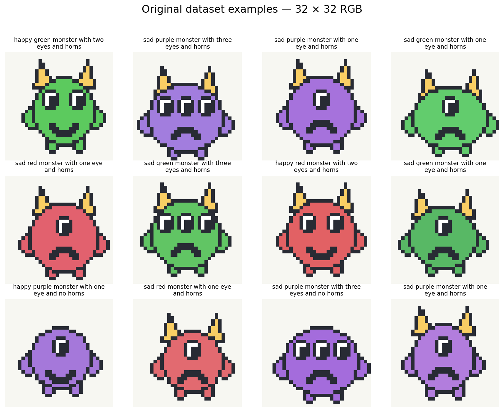

# Monster Generator — a tiny diffusion classroom

Train a small **text-conditioned diffusion model from scratch** in Google Colab, then generate 32×32 RGB monsters from a prompt such as:

> happy green monster with three eyes and horns

[](https://colab.research.google.com/github/dujing82-blip/tiny-text-to-pixel-ai/blob/main/monster_diffusion/Monster_Generator_Colab.ipynb)



## Start here

1. Click **Open in Colab**.
2. Select **Runtime → Change runtime type → GPU**. Use an A100 if available.
3. Run the notebook from top to bottom. Data downloads automatically; no uploads, accounts, API keys, or pretrained model downloads are needed.
4. After training, edit the prompt in **Section 8** or use the creative panel in **Section 12**.

The notebook, code comments, and student-facing explanations are in English. The [teacher guide](TEACHER_GUIDE.md) includes a 60-minute lesson plan, answer notes, and a classroom recording sheet.

## What students can control

| Attribute | Supported choices |
|---|---|
| Color | green, blue, red, purple |
| Eyes | one, two, three (also 1, 2, 3) |
| Horns | horns, no horns, without horns |
| Expression | happy/smiling, sad/frowning |
| Randomness | initial noise seed |
| Generation | sampling steps and guidance strength |

The model learns four **32-dimensional word embeddings** from scratch. The prompt parser supports a controlled vocabulary; it is not a general natural-language text encoder. Unknown words and conflicting colors/counts are rejected. Omitted expression means happy; omitted horns means no horns. The canonical interpretation is printed before generation.

## A complete diffusion learning loop

- View the prepared data and captions.
- Visualize forward noising and explain `alpha_bar`.
- Train a U-Net to predict the Gaussian noise added to each image.
- View measured training speed, loss and validation noise MSE.
- Generate multiple samples from one prompt.
- Watch actual intermediate noisy states and export a denoising GIF.
- Hold the starting noise fixed and change one attribute.
- Test four full attribute combinations deliberately absent from training.
- Save and resume training; download results or optionally save a checkpoint to Drive.

The generator used to prepare the dataset is **never called by the inference path**. New samples come from the learned noise predictor and iterative sampler.

## Data

All artwork is original and procedurally generated, with no external image dataset or licensing dependency. The **prebuilt dataset is committed to GitHub**, so students download it rather than spend classroom time generating it.

| Split | Images | Full combinations | Purpose |
|---|---:|---:|---|
| Training | 13,200 | 44 | Gradient updates |
| Validation | 880 | Same 44 | Fresh rendering variations, no gradient updates |
| Unseen combinations | 400 | 4 excluded from training | Compositional experiment |
| Total | 14,480 | 48 | 32×32 RGB uint8 images |

The held-out full combinations are:

- happy green monster with three eyes and horns
- sad blue monster with one eye and no horns
- sad red monster with two eyes and horns
- happy purple monster with three eyes and no horns

Every individual attribute appears in training. The split does **not** reserve a whole color or eye count. Since the procedural art uses a small number of visual variations, independent rendered images can be very similar; this is a concept-composition teaching task, not a demanding image-diversity benchmark.

`data/monsters32.npz` stores `images` (NHWC uint8), `labels` (four categorical IDs), and `splits` (0/1/2). `data/metadata.json` lists the vocabulary, counts, seed, held-out prompts and SHA-256. Downloads are checked against embedded notebook hashes.

To reproduce the data outside the lesson:

```bash
python dataset.py --output data
```

## Model and runtime

| Setting | Default |
|---|---|
| Model | Conditional residual U-Net; 947,363 trainable parameters |
| Spatial sizes | 32 → 16 → 8 → 16 → 32, with skip connections |
| Text features | Four trainable 32-number attribute embeddings |
| Objective | Gaussian noise prediction, mean squared error |
| Noise process | 256 training levels, cosine schedule |
| Training | 4,000 additional optimizer steps, batch 128, AdamW, learning rate 0.0002 |
| Stability | Gradient clipping, CUDA mixed precision, EMA sampling weights |
| Text dropout | 10% for classifier-free guidance |
| Sampling | DDIM, eta=0, 64 steps, guidance 2 |
| Training time budget | 24 minutes per call; saves progress at the end |

**Approximately 30 minutes on A100 is a classroom target, not an A100 benchmark.** The log measures the actual rate on the assigned runtime. Setup, preview generation, saving and sampling add time. T4 may require more time or a resumed training run. The notebook does not promise correct eye counts or clean expression shapes after a fixed number of minutes.

GPU availability depends on the user's Colab account. The code also runs on CPU for validation or local use, with slower training. PyTorch comes with the Colab runtime; the notebook keeps that GPU-compatible installation.

## Resume and keep work

Set `RESUME=True` in Section 5 to restore the local checkpoint. `TRAIN_STEPS` means **additional steps**, not a target total. Resume restores the saved architecture, batch size and learning rate. For a fresh model or a smaller batch, use `RESUME=False`.

Checkpoints are saved every 500 steps and when training ends or is interrupted. They include model/EMA weights, optimizer, scaler, dataset checksum, history and training random state. A fully terminated runtime cannot run a final save, so keep an external checkpoint copy. The optional export cell can download all results or save the checkpoint to Google Drive.

## Local use and verification

From this folder:

```bash
pip install -r requirements.txt
python -m unittest discover -s tests -v
python run.py train --steps 4000 --minutes 24
python run.py sample --prompt 'happy blue monster with two eyes and horns'
python run.py train --resume --steps 1000 --minutes 10
```

The tests cover controlled prompts, original artwork reproducibility, split exclusions, forward diffusion equations, oracle reverse denoising, repeatable sampling, training updates, validation and checkpoint resume. `tests/smoke_notebook.py` executes every notebook code cell with a tiny CPU model and two training steps. This smoke test validates the flow, not trained image quality or GPU timing.

Code and original data are covered by the repository's [MIT license](../LICENSE).

## References

- Ho et al., [Denoising Diffusion Probabilistic Models](https://arxiv.org/abs/2006.11239).
- Nichol & Dhariwal, [Improved Denoising Diffusion Probabilistic Models](https://arxiv.org/abs/2102.09672).
- Song et al., [Denoising Diffusion Implicit Models](https://arxiv.org/abs/2010.02502).
- Ho & Salimans, [Classifier-Free Diffusion Guidance](https://arxiv.org/abs/2207.12598).
- [PyTorch AMP examples](https://docs.pytorch.org/docs/stable/notes/amp_examples.html).
